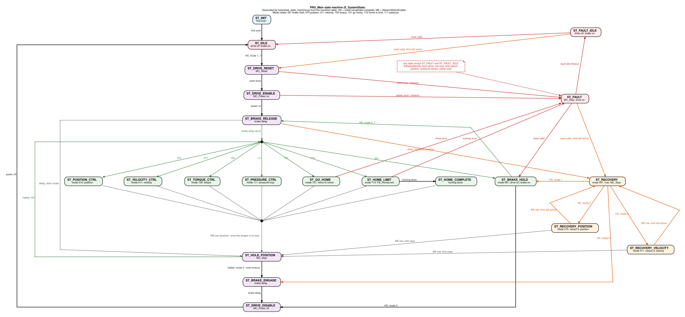

# State Transition Diagram

## Gen3 SOS Compressor Servo Controller
### Visual State Machine Reference

---

## 1. High-Level State Overview

The full machine, every state of `E_SystemState` and every transition
`PRG_Main` makes, is drawn in
[MainStateMachine.svg](../slave/diagrams/MainStateMachine.svg):



The drawing is generated by `tools/draw_state_machine.py` from a transition
table that the script checks against `E_SystemState` and the branches of
`PRG_Main`; run `python3 tools/draw_state_machine.py` after changing either,
and `--check` to compare without drawing. The sections below are the text
version.

```
                           POWER ON
                               |
                               v
+------------------------------------------------------------------+
|                    INITIALIZATION PHASE                           |
|  +----------+                                                     |
|  | ST_INIT  | --> First scan transitions directly to ST_IDLE     |
|  |          |                                                     |
|  +----------+                                                     |
+------------------------|-----------------------------------------+
                         |
                         v
                    +----------+
                    | ST_IDLE  |
                    +----------+
                           |
            (mode handshake complete:
             mode 1..7 confirmed, MotionEnable high)
                           |
            +--------------+--------------+
            |                             |
     (Homing Modes              (Operational Modes
      101,110)                   001,010,011,100,111)
            |                             |
            +----------+------------------+
                       |
                       v
              +----------------+
              | ST_DRIVE_RESET |
              +----------------+
                       |
                       v
              +----------------+
              | ST_DRIVE_ENABLE|
              +----------------+
                       |
                       v
              +----------------+
              | ST_BRAKE       |
              | _RELEASE       |
              +----------------+
                       |
         +------+------+------+------+------+------+------+
         |      |      |      |      |      |      |      |
         v      v      v      v      v      v      v
       001    010    011    100    111    101    110
       BRAKE  POS    VEL    TRQ    PRES   GO     HOME
       HOLD   CTRL   CTRL   CTRL   CTRL   HOME   LIMIT
```

---

## 2. Operational State Flow

```
                    OPERATIONAL STATES
    +------------------------------------------------+
    |                                                |
    |   +----------+    +----------+    +----------+ |
    |   | POSITION |    | VELOCITY |    | TORQUE   | |
    |   | CTRL     |    | CTRL     |    | CTRL     | |
    |   | (010)    |    | (011)    |    | (100)    | |
    |   +----+-----+    +----+-----+    +----+-----+ |
    |        |              |              |         |
    |        +------+-------+------+-------+         |
    |               |              |                 |
    |      (MotionEnable       (fault detected)       |
    |       = LOW)                                  |
    |               |              |                 |
    |               v              v                 |
    |        +-------------+  +-----------+          |
    |        | ST_HOLD     |  | ST_FAULT  |          |
    |        | _POSITION   |  |           |          |
    |        +------+------+  +-----------+          |
    |               |                                |
    |      (New mode handshake, halted)              |
    |               |                                |
    |        +------v------+                         |
    |        | New Mode    |                         |
    |        | (directly;  |                         |
    |        |  the brake  |                         |
    |        |  stays off) |                         |
    |        +-------------+                         |
    +------------------------------------------------+
```

`ST_PRESSURE_CTRL` (mode 111) behaves like `ST_VELOCITY_CTRL`, except that the
velocity command comes from `FB_PressureController` closing the loop on the
pressure transducer, with the reference as the target pressure in MPa gauge.
It applies `G_cfgPressureVelMax` and `G_cfgPressureTorqueLimit` and leaves
through the same hold-position and fault paths as the other operational modes.
`ST_POSITION_CTRL` (and `ST_RECOVERY_POSITION`) first brakes the shaped command
to rest after MotionEnable drops, then enters `ST_HOLD_POSITION`; the other
operational states enter it on the first scan with MotionEnable low. A mode
change from an operational state always goes through `ST_HOLD_POSITION`; only
`ST_BRAKE_HOLD` (brake engaged) re-enters the brake release sequence.

---

## 3. Homing State Sequences

> **Note on FB-to-motion-FB references.** The `Jog` and `MC_MoveAbsolute` labels in the diagrams below are shorthand. The actual control flow is: the custom homing FB writes to its `CmdXxx` `VAR_OUTPUT`, `PRG_Main` copies that into the `G_cmd*` global, and the Ladder Diagram POU's built-in FB acts on it. Status returns via the paired `G_sta*` global into the FB's `StaXxx` `VAR_INPUT`. See the [System Architecture](../slave/development/SystemArchitecture.md) document for the full wiring.

### Mode 110: Home to Limit Switch

```
+---------------+
| ST_HOME_LIMIT |  Entry point from mode command
+-------+-------+  (FB_HomeLimit executes internally)
        |
        v
  [FB_HomeLimit internal steps]
        |
+-------------------+
| FAST_APPROACH      |  Jog Reverse @ FastApproachVelocity
|                   |  Moving toward negative overtravel / home switch
+-------+-----------+
        |
        | (OvertravelNegActive = TRUE)
        v
+-------------------+
| FAST_AWAIT         |  Wait for Jog to decelerate to a stop
+-------+-----------+
        |
        v
+-------------------+
| INTER_BACKOFF      |  Jog Forward @ BackoffVelocity
|                   |  Off the switch, just far enough to clear it
+-------+-----------+
        |
        | (OvertravelNegActive = FALSE)
        v
+-------------------+
| INTER_AWAIT        |  Wait for Jog to decelerate to a stop
+-------+-----------+
        |
        v
+-------------------+
| SLOW_APPROACH      |  Jog Reverse @ SlowApproachVelocity
|                   |  Precise re-detect; captures switch position
+-------+-----------+
        |
        | (OvertravelNegActive = TRUE)
        v
+-------------------+
| SLOW_AWAIT         |  Wait for Jog to decelerate to a stop
+-------+-----------+
        |
        v
+-------------------+
| RETRACT            |  MC_MoveAbsolute(switch position + RetractDist)
|                   |  Backs off the switch by exactly RetractDist
+-------+-----------+
        |
        v
+-------------------+
| RETRACT_AWAIT      |  Wait for MC_MoveAbsolute.Done
+-------+-----------+
        |
        v
+-------------------+
| SETREF             |  CmdSetPosition.Execute -> G_cmdSetPosition
|                   |  -> MC_SetPosition (LD POU); retract endpoint
+-------+-----------+  becomes the new coordinate-frame zero
        |
        v
+---------------+
| ST_HOME       |  PRG_Main sets G_flagHomingComplete and
| _COMPLETE     |  G_sysHomingComplete; wait for mode change
+---------------+
```

### Mode 101: Go Home

```
+---------------+
| ST_GO_HOME    |  Entry point from mode command
+-------+-------+
        |
        v
+-------------------+
| MC_MoveAbsolute   |
| to HomePosition   |
+--------+----------+
         |
         | (At position)
         v
+---------------+
| Hold position |
| until mode    |
| change        |
+---------------+
```

---

## 4. Fault Handling Flow

```
        ANY STATE EXCEPT ST_FAULT, ST_FAULT_IDLE
            |
            | (fbSafetyMonitor reports a fault; drive, link loss,
            |  limit switch, position, pressure sensor, piston exit.
            |  ST_DRIVE_RESET ignores a drive fault: its own timeout
            |  and MC_Reset error fault it.)
            v
    +---------------+
    | ST_FAULT      |
    |               |
    | - G_sysFaultActive = HIGH
    | - Fault code in IR4 (G_mbFaultCode)
    | - MC_Stop (motion stopped)
    +-------+-------+
            |
            +---------------------------+
            |                           |
    (Fast recovery:                (Slow recovery:
     FaultReset HIGH                  G_cfgFaultIdleTimeout
     + valid mirrored code          expires)
     + MotionEnable LOW)                  |
            |                           v
            v                   +---------------+
    +---------------+           | ST_FAULT_IDLE |
    | ST_BRAKE_HOLD |           |               |
    | (drive stays  |           | - Brake engaged
    |  enabled)     |           | - Drive disabled
    +---------------+           | - G_sysFaultActive = HIGH
                                +-------+-------+
                                        |
                                (FaultReset HIGH
                                 + valid mirrored code
                                 + MotionEnable LOW)
                                        |
                                        v
                                +---------------+
                                | ST_IDLE       |
                                +---------------+
```

### Limit Recovery on Reset

When the cleared fault was `FAULT_LIMIT_SWITCH` or `FAULT_POSITION` **and** a limit
is still active at reset (switch held or position beyond a soft limit), the reset
routes into the recovery sub-machine instead of the normal targets above:

```
   ST_FAULT --reset, limit still active--------------------> ST_RECOVERY
   ST_FAULT_IDLE --reset, limit still active--> (DRIVE_RESET
                              -> DRIVE_ENABLE -> BRAKE_RELEASE) -> ST_RECOVERY
            (re-enable sequence; carried by bRecoveryPending)

   ST_RECOVERY  (drive ON, brake released, position held via MC_Stop)
        |  select MODE_POSITION (010) / MODE_VELOCITY (011) + MotionEnable
        v
   ST_RECOVERY_POSITION / ST_RECOVERY_VELOCITY
        |  jog AWAY from the limit (toward-limit commands are clamped to zero)
        |
        +-- MotionEnable toggle, limit still active --> ST_RECOVERY (keep jogging)
        +-- MotionEnable toggle, limit cleared -------> ST_HOLD_POSITION (normal)

   ST_RECOVERY --select MODE_BRAKE_HOLD--> ST_BRAKE_HOLD   (manual exit, drive on)
   ST_RECOVERY --select MODE_IDLE-------> ST_BRAKE_ENGAGE  (shutdown)
```

If the limit has already cleared at reset, the normal `ST_BRAKE_HOLD` / `ST_IDLE`
targets apply (no recovery detour). Limit-switch and position faults are suppressed
while in recovery; drive and piston-exit faults stay active, and so does link
loss in the two retract states. See the
[Fault Code Reference](FaultCodeReference.md#limit-recovery-state-st_recovery) for
the master-side procedure.

---

## 5. Valid Mode Transitions

### From IDLE (Mode 000)

| To Mode | Condition | Path |
|---------|-----------|------|
| 001 (Brake Hold) | Handshake complete | DRIVE_RESET → DRIVE_ENABLE → BRAKE_RELEASE → BRAKE_HOLD |
| 010 (Position) | Handshake complete | DRIVE_RESET → DRIVE_ENABLE → BRAKE_RELEASE → POSITION_CTRL |
| 011 (Velocity) | Handshake complete | DRIVE_RESET → DRIVE_ENABLE → BRAKE_RELEASE → VELOCITY_CTRL |
| 100 (Torque) | Handshake complete | DRIVE_RESET → DRIVE_ENABLE → BRAKE_RELEASE → TORQUE_CTRL |
| 101 (Go Home) | Handshake complete | DRIVE_RESET → DRIVE_ENABLE → BRAKE_RELEASE → GO_HOME |
| 110 (Home Limit) | Handshake complete | DRIVE_RESET → DRIVE_ENABLE → BRAKE_RELEASE → HOME_LIMIT |
| 111 (Pressure) | Handshake complete | DRIVE_RESET → DRIVE_ENABLE → BRAKE_RELEASE → PRESSURE_CTRL |

A drive reset error, a drive enable error or either timeout
(`G_cfgDriveReadyTimeout`) faults with `FAULT_DRIVE`.

### From Operational Modes

| From | To | Condition | Path |
|------|----|-----------| -----|
| BRAKE_HOLD | Mode 010..111 | Handshake complete | BRAKE_RELEASE → New Mode |
| BRAKE_HOLD | IDLE (000) | Handshake complete with mode 0 | DRIVE_DISABLE → IDLE |
| Any other Operational | Different Mode | MotionEnable LOW, then handshake for the new mode | HOLD_POSITION → New Mode (no brake release) |
| Any other Operational | IDLE (000) | MotionEnable LOW and mode code 0, or the hold-position watchdog times out | HOLD_POSITION → BRAKE_ENGAGE → DRIVE_DISABLE → IDLE (graceful, no fault) |
| Any state but the fault states | FAULT | Fault detected | Direct transition |

### Homing Mode Exits

| From | To | Condition | Path |
|------|----|-----------| -----|
| HOME_COMPLETE | Any Mode | MotionEnable LOW, then a new mode handshake | HOLD_POSITION → New Mode |
| HOME_LIMIT | FAULT | `FB_HomeLimit` error (`FAULT_LIMIT_SWITCH`), or a positive overtravel switch | Direct transition |

---

## 6. State Enumeration Reference

The enum uses dense sequential numbering (0, 1, 2, ...). Code never references numeric values directly.

```
STATE                      DESCRIPTION
-----------------------------------------------------
ST_INIT                    Default initializer (first scan -> ST_IDLE)
ST_IDLE                    Drive OFF, awaiting commands
ST_DRIVE_RESET             Clearing drive alarms (MC_Reset)
ST_DRIVE_ENABLE            Powering on drive
ST_BRAKE_RELEASE           Releasing brake
ST_BRAKE_HOLD              Mode 001: Drive ON, brake ON
ST_POSITION_CTRL           Mode 010: Position control
ST_VELOCITY_CTRL           Mode 011: Velocity control
ST_TORQUE_CTRL             Mode 100: Torque control
ST_PRESSURE_CTRL           Mode 111: Pressure control
ST_GO_HOME                 Mode 101: Go home sequence
ST_HOME_LIMIT              Mode 110: Homing (FB_HomeLimit)
ST_HOME_COMPLETE           Homing done
ST_HOLD_POSITION           Controlled stop, await mode
ST_BRAKE_ENGAGE            Engaging brake
ST_DRIVE_DISABLE           Powering off drive
ST_FAULT                   Fault active
ST_FAULT_IDLE              Safe powered-down fault state
ST_RECOVERY                Limit-recovery hub: drive ON, brake released, held via MC_Stop
ST_RECOVERY_POSITION       Position-control retract (direction clamped away from limit)
ST_RECOVERY_VELOCITY       Velocity-control retract (direction clamped away from limit)
```

---

## 7. Master State Machine

The master should implement a complementary state machine:

```
MASTER STATES
+----------------------------------------------------------+
|                                                          |
|  +--------+                                              |
|  | INIT   | --> Connect, zero holding registers          |
|  +----+---+                                              |
|       |                                                  |
|       v                                                  |
|  +--------+                                              |
|  | IDLE   | <--+  Monitor G_mbFaultActive                  |
|  +----+---+    |  Mode code = 0                          |
|       |        |                                         |
|       | (Mode request)                                   |
|       v        |                                         |
|  +----------+  |                                         |
|  | REQUEST  |  |  Set mode code (MotionEnable stays       |
|  | _MODE    |  |  LOW); start handshake timer             |
|  +----+-----+  |                                         |
|       |        |                                         |
|   +---+---+    |                                         |
|   |       |    |                                         |
| (Match:  (Timeout)                                       |
|  raise                                                    |
|  MotionEnable)                                            |
|   |       |    |                                         |
|   v       v    |                                         |
|  +------+ +----+---+                                     |
|  | OPER | | TIMEOUT|  Handle timeout (wait for fault)    |
|  | ATING| | _WAIT  |                                     |
|  +--+---+ +--------+                                     |
|     |          |                                         |
|     | (Mode change)                                      |
|     v          |                                         |
|  +--------+    |                                         |
|  | STOP   |----+  Drop MotionEnable, wait for halt         |
|  | _MOTION|                                              |
|  +--------+                                              |
|                                                          |
|  +--------+                                              |
|  | FAULT  | <-- When G_mbFaultActive goes HIGH             |
|  | _HANDLE|     Read code, mirror, reset                 |
|  +----+---+                                              |
|       |                                                  |
|       | (Fault cleared)                                  |
|       v                                                  |
|  +--------+                                              |
|  | IDLE   |                                              |
|  +--------+                                              |
|                                                          |
+----------------------------------------------------------+
```

---

## 8. Timing Considerations

### Critical Timing Points

| Transition | Timing | Notes |
|------------|--------|-------|
| Mode request → Confirm | < 500 ms | Handshake timeout |
| MotionEnable LOW → InMotion (IR6) LOW | Variable | Deceleration time |
| Fault detect → Fault code stable | < 10 ms | Wait before reading |
| FaultReset asserted → FaultActive (IR5) LOW | < 1000 ms | Reset timeout (level-based, not edge) |
| Brake engage → Brake hold | `G_cfgBrakeEngageDelay` (500 ms) | Mechanical delay |
| Brake release → Motion allowed | `G_cfgBrakeDisengageDelay` (500 ms) | Mechanical delay |

### State Transition Timing

```
Time ------>

MotionEnable      __________/‾‾‾‾‾‾‾‾‾‾‾‾‾‾‾‾‾‾‾‾‾‾\___________
                            ^                        ^
                            |                        |
                         Confirmed ->              Stop
                         raised HIGH               motion

Slave State     IDLE | RESET | ENABLE | RELEASE | OPERATING | HOLD | ENGAGE | IDLE
                                       |<-500ms->|                  |<-500ms->|

Mode Confirm    0___/‾‾‾\_____0__________________________|__0_____
                    ^   ^
                    |   |
                 Request Confirmed - handshake manager disables as
                 mode    soon as ST_IDLE is left, so IR3 reads 0
                 code    through OPERATING/HOLD and during a
                         fault; this is normal, not a
                         loss of mode
```

---

## 9. Decision Points Summary

### At ST_IDLE
- Check: Mode handshake complete (mode code confirmed, then MotionEnable
  (`G_mbMotionEnable`) raised) with an operational or homing mode (1..7)? →
  `ST_DRIVE_RESET`

### At Operational State
- Check: MotionEnable (`G_mbMotionEnable`) LOW → ST_HOLD_POSITION (a level check, so a drop during drive reset, enable or brake release still stops the mode on its first scan; position control first brakes its shaped command to rest)
- Check: Fault condition → ST_FAULT (a mode change does not fault)
- `ST_BRAKE_HOLD`: mode handshake with mode 0 → ST_DRIVE_DISABLE, with mode 2..7 → ST_BRAKE_RELEASE

### At ST_HOLD_POSITION
- Check: motion halted (MC_Stop done and Y_DirectControl released)? Nothing
  else leaves the state before that.
- Check: Mode code = 0, or hold-position watchdog (`G_cfgHoldPositionTimeout`)
  expires → graceful shutdown to ST_IDLE via ST_BRAKE_ENGAGE → ST_DRIVE_DISABLE
  (no fault, no handshake needed)
- Check: new mode handshake complete → the state of the new mode directly
  (a handshake that times out only returns the handshake manager to idle; it
  is not a fault)

### At ST_FAULT
- Check: Valid reset handshake?
- Check: Fault condition persists after reset?
- Check: Was it a limit/position fault with the limit still active? → route to `ST_RECOVERY`
  (from `ST_FAULT_IDLE`, re-enable the drive first) instead of `ST_BRAKE_HOLD`/`ST_IDLE`.

### At ST_RECOVERY (and sub-states)
- Check: Mode select `MODE_POSITION`/`MODE_VELOCITY` → enter retract sub-state.
- Check: Commanded direction toward the active limit → clamp command to zero (no fault).
- Check: MotionEnable (`G_mbMotionEnable`) toggle → limit cleared? `ST_HOLD_POSITION` (normal) : `ST_RECOVERY` (keep jogging).
- Check: Mode select `MODE_BRAKE_HOLD`/`MODE_IDLE` → leave recovery.
