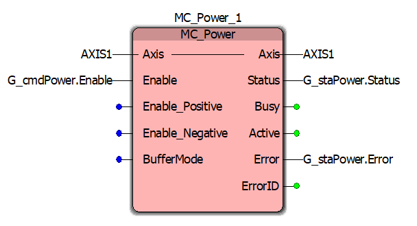
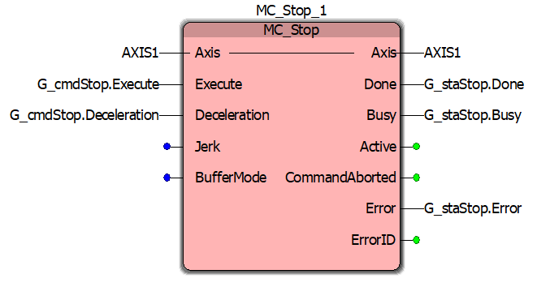
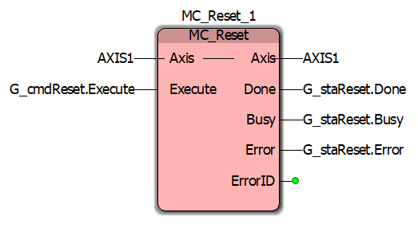
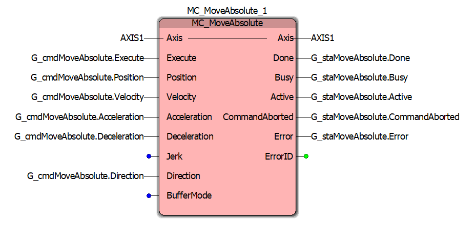
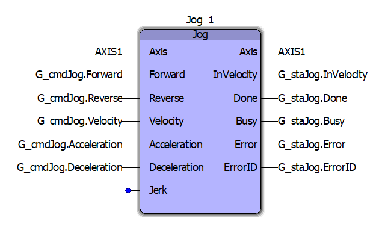
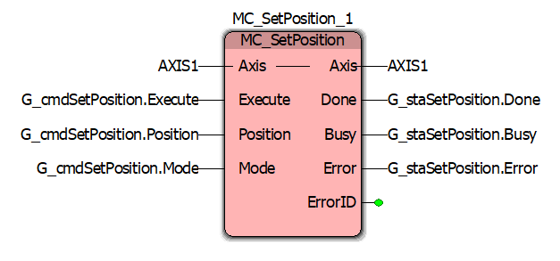
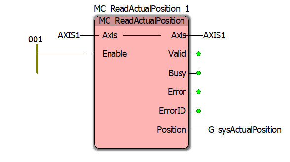
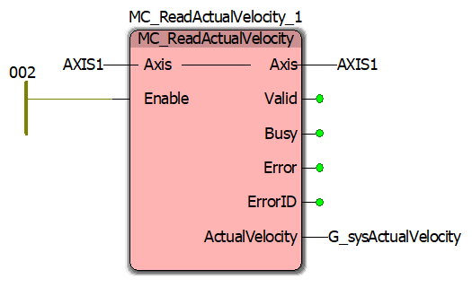
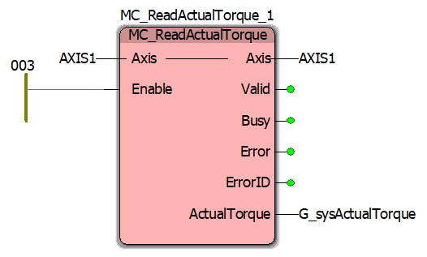

# Ladder Diagram POU wiring record

The LD POU that owns `G_sysAxis` and the built-in motion function blocks
lives only in the MotionWorks IEC project; it cannot be exported as text.
This directory records its wiring block by block: a screenshot of each
block as it is in the project, and a table of what is wired to each pin.
The Structured Text writes the `G_cmd*` structs and reads the `G_sta*`
structs (`slave-src/DUT/DataTypes.st`), so this record is the contract
between the two halves. When a field is added to one of those structs,
the block's pin must be wired in the LD and the screenshot and table here
replaced.

Take the screenshot with the POU offline (online values show `???`) so
the pin labels are legible, name the file after the block instance, and
keep the table to what the picture shows.

## Y_DirectControl_1

| Pin | Direction | Wired to | Note |
|---|---|---|---|
| Axis | in | `AXIS1` | |
| Enable | in | `G_cmdDirectControl.Enable` | |
| ControlMode | in | `G_cmdDirectControl.ControlMode` | |
| Position | in | `G_cmdDirectControl.Position` | |
| Velocity | in | `G_cmdDirectControl.Velocity` | In PositionMode the block does no path shaping, so this input (and Acceleration) sets no limit; `FB_PositionPathShaper`'s `VelMax` and `AccelMax` do. |
| Acceleration | in | `G_cmdDirectControl.Acceleration` | The block has no Deceleration pin, so `ST_CmdDirectControl` has no `Deceleration` field. The bench measured no slew of the velocity reference at this value in VelocityTLMode (`bench/characterisation/README.md` section 8). |
| Torque | in | `G_cmdDirectControl.Torque` | |
| FilterTimeConstant | in | `G_cmdDirectControl.FilterTimeConstant` | `PRG_Main` sets it from `G_cfgDirectCtrlFilterTime` (default 0.05 s), so the filter is tuned in the GVL. |
| BufferMode | in | not wired | |
| Axis | out | `AXIS1` | |
| Busy | out | not wired | |
| Active | out | `G_staDirectControl.Active` | |
| CommandAborted | out | not wired | |
| Error | out | `G_staDirectControl.Error` | Read by `PRG_Main` in the hand-off to `MC_Stop`. |
| ErrorID | out | not wired | |

## MC_Power_1

| Pin | Direction | Wired to | Note |
|---|---|---|---|
| Axis | in | `AXIS1` | |
| Enable | in | `G_cmdPower.Enable` | |
| Enable_Positive | in | not wired | `PRG_Main` writes `G_cmdPower.EnablePositive`; see "To change: wire `MC_Power`'s direction enables". |
| Enable_Negative | in | not wired | `PRG_Main` writes `G_cmdPower.EnableNegative`; same. |
| BufferMode | in | not wired | |
| Axis | out | `AXIS1` | |
| Status | out | `G_staPower.Status` | Read by `PRG_Main` in `ST_DRIVE_ENABLE` and as the drive-dropped check in the deactivation states. |
| Busy | out | not wired | |
| Active | out | not wired | |
| Error | out | `G_staPower.Error` | Read by `PRG_Main` in `ST_DRIVE_ENABLE` (`FAULT_DRIVE`). |
| ErrorID | out | not wired | |

## MC_Stop_1

| Pin | Direction | Wired to | Note |
|---|---|---|---|
| Axis | in | `AXIS1` | |
| Execute | in | `G_cmdStop.Execute` | |
| Deceleration | in | `G_cmdStop.Deceleration` | `PRG_Main` sets it from `G_cfgStopDecel` (hold, fault and recovery); `FB_GoHome` overrides the struct while it owns the axis. |
| Jerk | in | not wired | |
| BufferMode | in | not wired | |
| Axis | out | `AXIS1` | |
| Done | out | `G_staStop.Done` | Read by `PRG_Main` in the hold/fault/recovery states and by `FB_GoHome`. |
| Busy | out | `G_staStop.Busy` | Read by `PRG_Main` in the hand-off from `Y_DirectControl`. |
| Active | out | not wired | |
| CommandAborted | out | not wired | |
| Error | out | `G_staStop.Error` | Read by `PRG_Main` in the hand-off and by `FB_GoHome`. |
| ErrorID | out | not wired | |

## MC_Reset_1

| Pin | Direction | Wired to | Note |
|---|---|---|---|
| Axis | in | `AXIS1` | |
| Execute | in | `G_cmdReset.Execute` | TRUE only in `ST_DRIVE_RESET`. |
| Axis | out | `AXIS1` | |
| Done | out | `G_staReset.Done` | Read by `PRG_Main` in `ST_DRIVE_RESET`. |
| Busy | out | `G_staReset.Busy` | Not read by the ST. |
| Error | out | `G_staReset.Error` | Read by `PRG_Main` in `ST_DRIVE_RESET` (`FAULT_DRIVE`). |
| ErrorID | out | not wired | |

## MC_MoveAbsolute_1

| Pin | Direction | Wired to | Note |
|---|---|---|---|
| Axis | in | `AXIS1` | |
| Execute | in | `G_cmdMoveAbsolute.Execute` | The struct is written whole from `FB_GoHome.CmdMoveAbsolute` or `FB_HomeLimit.CmdMoveAbsolute` while those blocks own the axis; otherwise `PRG_Main` holds Execute FALSE. |
| Position | in | `G_cmdMoveAbsolute.Position` | |
| Velocity | in | `G_cmdMoveAbsolute.Velocity` | |
| Acceleration | in | `G_cmdMoveAbsolute.Acceleration` | Default `G_cfgMoveAccel`. |
| Deceleration | in | `G_cmdMoveAbsolute.Deceleration` | Default `G_cfgGoHomeDecel`. |
| Jerk | in | not wired | |
| Direction | in | `G_cmdMoveAbsolute.Direction` | `MC_Direction`; `PRG_Main` sets `Current_Direction`. |
| BufferMode | in | not wired | |
| Axis | out | `AXIS1` | |
| Done | out | `G_staMoveAbsolute.Done` | Read by `FB_GoHome` and `FB_HomeLimit`. |
| Busy | out | `G_staMoveAbsolute.Busy` | Read by `FB_HomeLimit`. |
| Active | out | `G_staMoveAbsolute.Active` | Not read by the ST. |
| CommandAborted | out | `G_staMoveAbsolute.CommandAborted` | Read by `FB_GoHome` and `FB_HomeLimit`. |
| Error | out | `G_staMoveAbsolute.Error` | Read by `FB_GoHome` and `FB_HomeLimit`. |
| ErrorID | out | not wired | |

## Jog_1

| Pin | Direction | Wired to | Note |
|---|---|---|---|
| Axis | in | `AXIS1` | |
| Forward | in | `G_cmdJog.Forward` | The struct is written whole from `FB_HomeLimit.CmdJog` while homing; otherwise `PRG_Main` holds Forward and Reverse FALSE. |
| Reverse | in | `G_cmdJog.Reverse` | |
| Velocity | in | `G_cmdJog.Velocity` | |
| Acceleration | in | `G_cmdJog.Acceleration` | Default `G_cfgMoveAccel`. |
| Deceleration | in | `G_cmdJog.Deceleration` | Default `G_cfgHomeLimDecel`; the block stops on it when an abort drops Forward/Reverse. |
| Jerk | in | not wired | |
| Axis | out | `AXIS1` | |
| InVelocity | out | `G_staJog.InVelocity` | Not read by the ST. |
| Done | out | `G_staJog.Done` | Read by `FB_HomeLimit`. |
| Busy | out | `G_staJog.Busy` | Read by `FB_HomeLimit`. |
| Error | out | `G_staJog.Error` | Read by `FB_HomeLimit`. |
| ErrorID | out | `G_staJog.ErrorID` | Not read by the ST. |

## MC_SetPosition_1

| Pin | Direction | Wired to | Note |
|---|---|---|---|
| Axis | in | `AXIS1` | |
| Execute | in | `G_cmdSetPosition.Execute` | The struct is written whole from `FB_HomeLimit.CmdSetPosition` while homing; otherwise `PRG_Main` holds Execute FALSE. |
| Position | in | `G_cmdSetPosition.Position` | |
| Mode | in | `G_cmdSetPosition.Mode` | BOOL: FALSE absolute, TRUE relative. `PRG_Main` sets FALSE. |
| Axis | out | `AXIS1` | |
| Done | out | `G_staSetPosition.Done` | Read by `FB_HomeLimit`. |
| Busy | out | `G_staSetPosition.Busy` | Not read by the ST. |
| Error | out | `G_staSetPosition.Error` | Read by `FB_HomeLimit`. |
| ErrorID | out | not wired | |

## MC_ReadActualPosition_1

| Pin | Direction | Wired to | Note |
|---|---|---|---|
| Axis | in | `AXIS1` | |
| Enable | in | left power rail (network 001) | Always TRUE; there is no `G_cmd*` struct for the read blocks. |
| Axis | out | `AXIS1` | |
| Valid | out | not wired | The ST uses the position every scan without a validity check. |
| Busy | out | not wired | |
| Error | out | not wired | |
| ErrorID | out | not wired | |
| Position | out | `G_sysActualPosition` | mm; read throughout `PRG_Main` and the user FBs, published in IR11-12. |

## MC_ReadActualVelocity_1

| Pin | Direction | Wired to | Note |
|---|---|---|---|
| Axis | in | `AXIS1` | |
| Enable | in | left power rail (network 002) | Always TRUE. |
| Axis | out | `AXIS1` | |
| Valid | out | not wired | |
| Busy | out | not wired | |
| Error | out | not wired | |
| ErrorID | out | not wired | |
| ActualVelocity | out | `G_sysActualVelocity` | mm/s; `G_sysInMotion`, the exit guard and the probe read it, published in IR13-14. |

## MC_ReadActualTorque_1

| Pin | Direction | Wired to | Note |
|---|---|---|---|
| Axis | in | `AXIS1` | |
| Enable | in | left power rail (network 003) | Always TRUE. |
| Axis | out | `AXIS1` | |
| Valid | out | not wired | |
| Busy | out | not wired | |
| Error | out | not wired | |
| ErrorID | out | not wired | |
| ActualTorque | out | `G_sysActualTorque` | % of rated; the exit guard and the probe read it, published in IR15-16. |

## To change: wire `MC_Power`'s direction enables

`PRG_Main` sets `G_cmdPower.EnablePositive` and `G_cmdPower.EnableNegative`
TRUE together with `Enable` (and FALSE with it), but the `Enable_Positive`
and `Enable_Negative` pins of `MC_Power_1` are not wired, so the two fields
reach nothing and the pins take the block's unconnected default. In
MotionWorks, wire `Enable_Positive` to `G_cmdPower.EnablePositive` and
`Enable_Negative` to `G_cmdPower.EnableNegative`, and replace
`MC_Power_1.PNG` and the table above.

## To change: drive `G_sysDriveFault`

`FB_SafetyMonitor` takes `G_sysDriveFault` as its `DriveFault` input and
raises `FAULT_DRIVE` from it (`docs/master/FaultCodeReference.md`), and the
simulated slave sets it from `sl.hook.driveFault`. Nothing in the
Structured Text writes it, and no block in this record drives it: the
`MC_ReadActual*` blocks leave `Error` unwired and there is no screenshot
of a block that reports the axis error state. In MotionWorks, either add
the block that drives it (one that reports the axis error state, such as
`MC_ReadAxisError` or `MC_ReadStatus`) with its screenshot and table here,
or, if such a block already exists in the LD POU, add its screenshot and
table.

## To change: remove `MC_MoveVelocity`

`G_cmdMoveVelocity` and `G_staMoveVelocity` (types `ST_CmdMoveVelocity`
and `ST_StaMoveVelocity`) no longer exist in the Structured Text, and
nothing writes or reads them. In MotionWorks, delete the `MC_MoveVelocity`
instance from the LD POU together with the two globals and the two types,
and delete `MC_MoveVelocity_1.PNG`. Also delete the global `G_sysCycleCount`,
which `PRG_Main` no longer increments.
