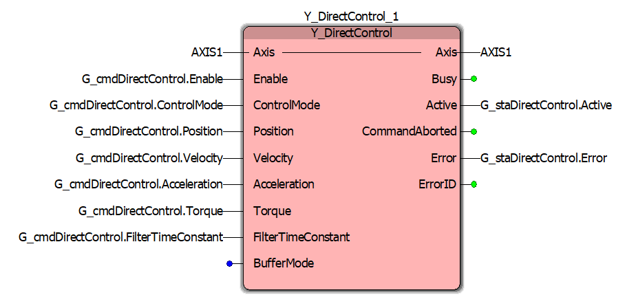

# Ladder Diagram POU wiring record

The LD POU (`PRG_LD`) that owns the axis and the built-in motion function
blocks lives only in the MotionWorks IEC project; it cannot be exported as
text. `slave-src/PRG/PRG_LD.st` is its specification, in the form of the
ST headers: the instances to declare and, network by network, what is
wired to each pin. This directory records the wiring as it is in the
project: a screenshot of each block, and a table of what is wired to each
pin. The screenshots are named after the project's instances
(`MC_Power_1` and so on); the specification names them in the project's
style (`fbPower`), and the axis `G_sysAxis` (`AXIS1` in the project).
The Structured Text writes the `G_cmd*` structs and reads the `G_sta*`
structs (`slave-src/DUT/DataTypes.st`), so this record is the contract
between the two halves. When a field is added to one of those structs,
the block's pin must be wired in the LD and the screenshot and table here
replaced.

Take the screenshot with the POU offline (online values show `???`) so
the pin labels are legible, name the file after the block instance, and
keep the table to what the picture shows.

## Y_DirectControl_1

| Pin | Direction | Wired to | Note |
|---|---|---|---|
| Axis | in | `AXIS1` | |
| Enable | in | `G_cmdDirectControl.Enable` | |
| ControlMode | in | `G_cmdDirectControl.ControlMode` | |
| Position | in | `G_cmdDirectControl.Position` | |
| Velocity | in | `G_cmdDirectControl.Velocity` | In PositionMode the block does no path shaping, so this input (and Acceleration) sets no limit; `FB_PositionPathShaper`'s `VelMax` and `AccelMax` do. |
| Acceleration | in | `G_cmdDirectControl.Acceleration` | The block has no Deceleration pin, so `ST_CmdDirectControl` has no `Deceleration` field. The bench measured no slew of the velocity reference at this value in VelocityTLMode (`bench/characterisation/README.md` section 8). |
| Torque | in | `G_cmdDirectControl.Torque` | |
| FilterTimeConstant | in | `G_cmdDirectControl.FilterTimeConstant` | `PRG_Main` sets it from `G_cfgDirectCtrlFilterTime` (default 0.05 s), so the filter is tuned in the GVL. |
| BufferMode | in | not wired | |
| Axis | out | `AXIS1` | |
| Busy | out | not wired | |
| Active | out | `G_staDirectControl.Active` | |
| CommandAborted | out | not wired | |
| Error | out | `G_staDirectControl.Error` | Read by `PRG_Main` in the hand-off to `MC_Stop`. |
| ErrorID | out | not wired | |

The other blocks (`MC_Power`, `MC_Stop`, `MC_Reset`, `MC_MoveAbsolute`,
`MC_SetPosition`, `MC_ReadActual*`, Jog) have their screenshots in this
directory and their pin lists in `slave-src/PRG/PRG_LD.st`. The screenshot
of `MC_Power_1` shows `Enable_Positive` and `Enable_Negative` open; the
specification wires them to `G_cmdPower.EnablePositive` and
`G_cmdPower.EnableNegative`, which the ST drives. `MC_ReadStatus`
(`fbReadStatus`, the source of `G_sysDriveFault`) has no screenshot yet.

## To change: remove `MC_MoveVelocity`

`G_cmdMoveVelocity` and `G_staMoveVelocity` (types `ST_CmdMoveVelocity`
and `ST_StaMoveVelocity`) no longer exist in the Structured Text, and
nothing writes or reads them. In MotionWorks, delete the `MC_MoveVelocity`
instance from the LD POU together with the two globals and the two types,
and delete `MC_MoveVelocity_1.PNG`. Also delete the global `G_sysCycleCount`,
which `PRG_Main` no longer increments.
