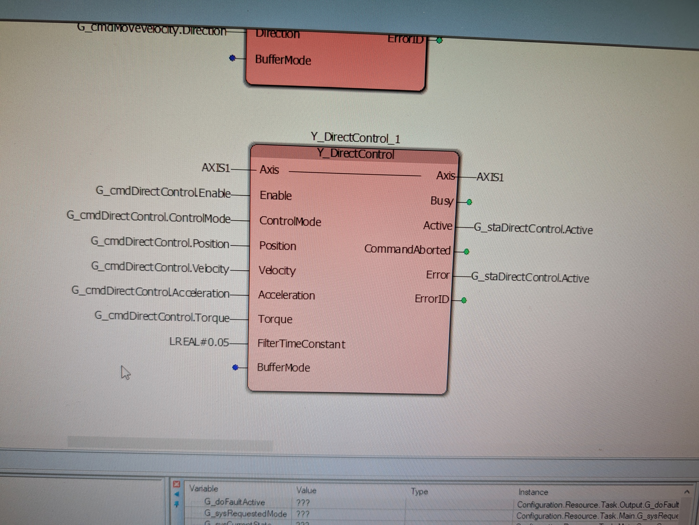

# Ladder Diagram POU wiring record

The LD POU that owns `G_sysAxis` and the built-in motion function blocks
lives only in the MotionWorks IEC project; it cannot be exported as text.
This directory records its wiring block by block: a screenshot of each
block as it is in the project, and a table of what is wired to each pin.
The Structured Text writes the `G_cmd*` structs and reads the `G_sta*`
structs (`slave-src/DUT/DataTypes.st`), so this record is the contract
between the two halves. When a field is added to one of those structs,
the block's pin must be wired in the LD and the screenshot and table here
replaced.

Take the screenshot with the POU offline (online values show `???`) so
the pin labels are legible, name the file after the block instance, and
keep the table to what the picture shows.

## Y_DirectControl_1

| Pin | Direction | Wired to | Note |
|---|---|---|---|
| Axis | in | `AXIS1` | |
| Enable | in | `G_cmdDirectControl.Enable` | |
| ControlMode | in | `G_cmdDirectControl.ControlMode` | |
| Position | in | `G_cmdDirectControl.Position` | |
| Velocity | in | `G_cmdDirectControl.Velocity` | |
| Acceleration | in | `G_cmdDirectControl.Acceleration` | The bench measured no slew of the velocity reference at this value in VelocityTLMode (`bench/characterisation/README.md` section 7). |
| Torque | in | `G_cmdDirectControl.Torque` | |
| FilterTimeConstant | in | `LREAL#0.05` | **To change:** wire `G_cmdDirectControl.FilterTimeConstant`, which `PRG_Main` sets from `G_cfgDirectCtrlFilterTime` (default 0.05 s), so the filter can be tuned without editing the LD. |
| BufferMode | in | not wired | |
| Axis | out | `AXIS1` | |
| Busy | out | not wired | |
| Active | out | `G_staDirectControl.Active` | |
| CommandAborted | out | not wired | |
| Error | out | `G_staDirectControl.Active` | **Wrong:** should be `G_staDirectControl.Error`, which `PRG_Main` reads (`PRG_Main.st`, stop path). As wired, a block error is never reported and `Active` is overwritten by the `Error` output. |
| ErrorID | out | not wired | |

The other blocks (`MC_Power`, `MC_Stop`, `MC_Reset`, `MC_MoveAbsolute`,
`MC_MoveVelocity`, `MC_SetPosition`, `MC_ReadActual*`, Jog) are not yet
recorded; the top of the screenshot shows the `MC_MoveVelocity`
instance's `Direction` and `BufferMode` pins only.
