# Ladder Diagram POU wiring record

The LD POU (`PRG_LD`) that owns the axis and the built-in motion function
blocks lives only in the MotionWorks IEC project; it cannot be exported as
text. `slave-src/PRG/PRG_LD.txt` is its specification, in the form of the
ST headers: the instances to declare and, network by network, what is
wired to each pin. This directory records the wiring as it is in the
project: a screenshot of each block, and a table of what is wired to each
pin. The screenshots and the tables are named after the instances of the
specification (`fbPower`, `fbStop` and so on). The axis wired to every
block's `Axis` pins is `AXIS1`, as in the specification; no screenshot
shows `G_sysAxis`. A pin shown with a green dot on an output or a blue dot on
an input is not wired.
The Structured Text writes the `G_cmd*` structs and reads the `G_sta*`
structs (`slave-src/DUT/DataTypes.st`), so this record is the contract
between the two halves. When a field is added to one of those structs,
the block's pin must be wired in the LD and the screenshot and table here
replaced.

Take the screenshot with the POU offline (online values show `???`) so
the pin labels are legible, name the file after the block instance, and
keep the table to what the picture shows.

## fbDirectControl

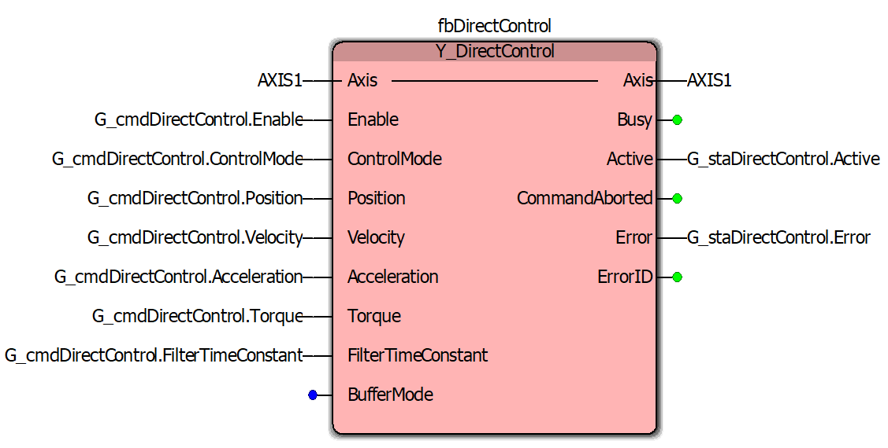

| Pin | Direction | Wired to | Note |
|---|---|---|---|
| Axis | in | `AXIS1` | |
| Enable | in | `G_cmdDirectControl.Enable` | |
| ControlMode | in | `G_cmdDirectControl.ControlMode` | |
| Position | in | `G_cmdDirectControl.Position` | |
| Velocity | in | `G_cmdDirectControl.Velocity` | In PositionMode the block does no path shaping, so this input (and Acceleration) sets no limit; `FB_PositionPathShaper`'s `VelMax` and `AccelMax` do. |
| Acceleration | in | `G_cmdDirectControl.Acceleration` | The block has no Deceleration pin, so `ST_CmdDirectControl` has no `Deceleration` field. The bench measured no slew of the velocity reference at this value in VelocityTLMode (`bench/characterisation/README.md` section 8). |
| Torque | in | `G_cmdDirectControl.Torque` | |
| FilterTimeConstant | in | `G_cmdDirectControl.FilterTimeConstant` | `PRG_Main` sets it from `G_cfgDirectCtrlFilterTime` (default 0.02 s), so the filter is tuned in the GVL. |
| BufferMode | in | not wired | |
| Axis | out | `AXIS1` | |
| Busy | out | not wired | |
| Active | out | `G_staDirectControl.Active` | |
| CommandAborted | out | not wired | |
| Error | out | `G_staDirectControl.Error` | Read by `PRG_Main` in the hand-off to `fbStop`. |
| ErrorID | out | not wired | |

## fbPower

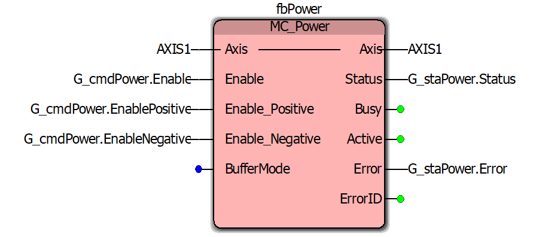

| Pin | Direction | Wired to | Note |
|---|---|---|---|
| Axis | in | `AXIS1` | |
| Enable | in | `G_cmdPower.Enable` | |
| Enable_Positive | in | `G_cmdPower.EnablePositive` | `PRG_Main` sets it TRUE with `Enable`. |
| Enable_Negative | in | `G_cmdPower.EnableNegative` | `PRG_Main` sets it TRUE with `Enable`. |
| BufferMode | in | not wired | |
| Axis | out | `AXIS1` | |
| Status | out | `G_staPower.Status` | Read by `PRG_Main` in `ST_DRIVE_ENABLE` and as the drive-dropped check in the deactivation states. |
| Busy | out | not wired | |
| Active | out | not wired | |
| Error | out | `G_staPower.Error` | Read by `PRG_Main` in `ST_DRIVE_ENABLE` (`FAULT_DRIVE`). |
| ErrorID | out | not wired | |

## fbStop

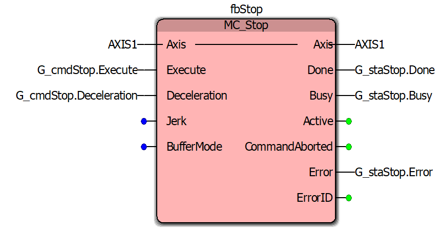

| Pin | Direction | Wired to | Note |
|---|---|---|---|
| Axis | in | `AXIS1` | |
| Execute | in | `G_cmdStop.Execute` | |
| Deceleration | in | `G_cmdStop.Deceleration` | `PRG_Main` sets it from `G_cfgStopDecel` (hold, fault and recovery); `FB_GoHome` overrides the struct while it owns the axis. |
| Jerk | in | not wired | |
| BufferMode | in | not wired | |
| Axis | out | `AXIS1` | |
| Done | out | `G_staStop.Done` | Read by `PRG_Main` in the hold/fault/recovery states and by `FB_GoHome`. |
| Busy | out | `G_staStop.Busy` | Read by `PRG_Main` in the hand-off from `Y_DirectControl`. |
| Active | out | not wired | |
| CommandAborted | out | not wired | |
| Error | out | `G_staStop.Error` | Read by `PRG_Main` in the hand-off and by `FB_GoHome`. |
| ErrorID | out | not wired | |

## fbReset

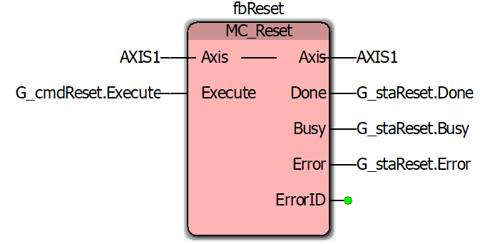

| Pin | Direction | Wired to | Note |
|---|---|---|---|
| Axis | in | `AXIS1` | |
| Execute | in | `G_cmdReset.Execute` | TRUE only in `ST_DRIVE_RESET`. |
| Axis | out | `AXIS1` | |
| Done | out | `G_staReset.Done` | Read by `PRG_Main` in `ST_DRIVE_RESET`. |
| Busy | out | `G_staReset.Busy` | Not read by the ST. |
| Error | out | `G_staReset.Error` | Read by `PRG_Main` in `ST_DRIVE_RESET` (`FAULT_DRIVE`). |
| ErrorID | out | not wired | |

## fbMoveAbsolute

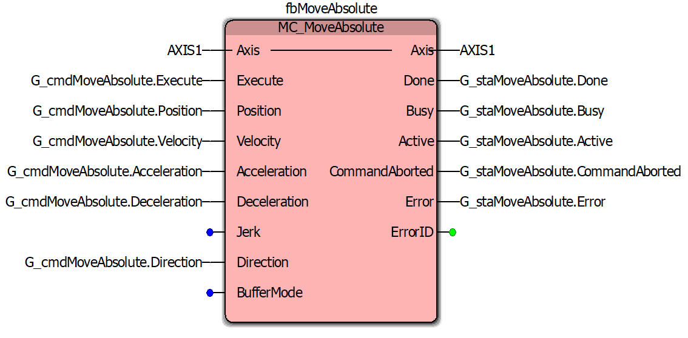

| Pin | Direction | Wired to | Note |
|---|---|---|---|
| Axis | in | `AXIS1` | |
| Execute | in | `G_cmdMoveAbsolute.Execute` | The struct is written whole from `FB_GoHome.CmdMoveAbsolute` or `FB_HomeLimit.CmdMoveAbsolute` while those blocks own the axis; otherwise `PRG_Main` holds Execute FALSE. |
| Position | in | `G_cmdMoveAbsolute.Position` | |
| Velocity | in | `G_cmdMoveAbsolute.Velocity` | |
| Acceleration | in | `G_cmdMoveAbsolute.Acceleration` | Default `G_cfgMoveAccel`. |
| Deceleration | in | `G_cmdMoveAbsolute.Deceleration` | Default `G_cfgGoHomeDecel`. |
| Jerk | in | not wired | |
| Direction | in | `G_cmdMoveAbsolute.Direction` | `MC_Direction`; `PRG_Main` sets `Current_Direction`. |
| BufferMode | in | not wired | |
| Axis | out | `AXIS1` | |
| Done | out | `G_staMoveAbsolute.Done` | Read by `FB_GoHome` and `FB_HomeLimit`. |
| Busy | out | `G_staMoveAbsolute.Busy` | Read by `FB_HomeLimit`. |
| Active | out | `G_staMoveAbsolute.Active` | Not read by the ST. |
| CommandAborted | out | `G_staMoveAbsolute.CommandAborted` | Read by `FB_GoHome` and `FB_HomeLimit`. |
| Error | out | `G_staMoveAbsolute.Error` | Read by `FB_GoHome` and `FB_HomeLimit`. |
| ErrorID | out | not wired | |

## fbJog

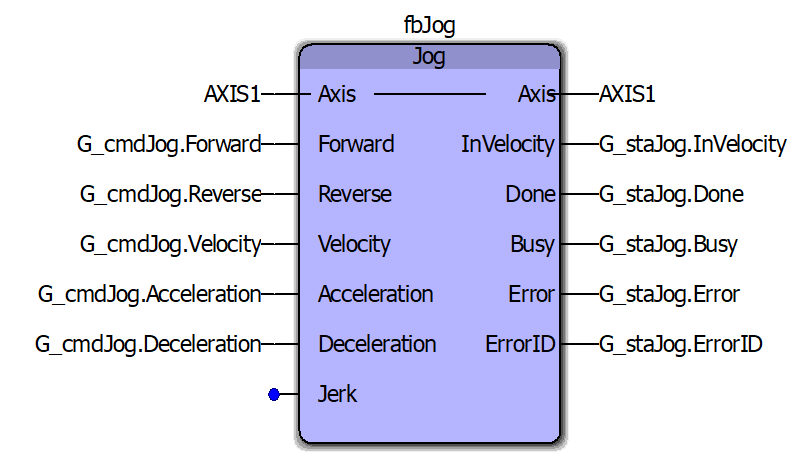

| Pin | Direction | Wired to | Note |
|---|---|---|---|
| Axis | in | `AXIS1` | |
| Forward | in | `G_cmdJog.Forward` | The struct is written whole from `FB_HomeLimit.CmdJog` while homing; otherwise `PRG_Main` holds Forward and Reverse FALSE. |
| Reverse | in | `G_cmdJog.Reverse` | |
| Velocity | in | `G_cmdJog.Velocity` | |
| Acceleration | in | `G_cmdJog.Acceleration` | Default `G_cfgMoveAccel`. |
| Deceleration | in | `G_cmdJog.Deceleration` | Default `G_cfgHomeLimDecel`; the block stops on it when an abort drops Forward/Reverse. |
| Jerk | in | not wired | |
| Axis | out | `AXIS1` | |
| InVelocity | out | `G_staJog.InVelocity` | Not read by the ST. |
| Done | out | `G_staJog.Done` | Read by `FB_HomeLimit`. |
| Busy | out | `G_staJog.Busy` | Read by `FB_HomeLimit`. |
| Error | out | `G_staJog.Error` | Read by `FB_HomeLimit`. |
| ErrorID | out | `G_staJog.ErrorID` | Not read by the ST. |

## fbSetPosition

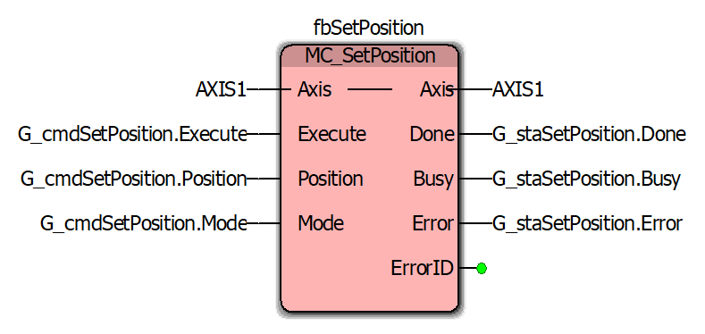

| Pin | Direction | Wired to | Note |
|---|---|---|---|
| Axis | in | `AXIS1` | |
| Execute | in | `G_cmdSetPosition.Execute` | The struct is written whole from `FB_HomeLimit.CmdSetPosition` while homing; otherwise `PRG_Main` holds Execute FALSE. |
| Position | in | `G_cmdSetPosition.Position` | |
| Mode | in | `G_cmdSetPosition.Mode` | BOOL: FALSE absolute, TRUE relative. `PRG_Main` sets FALSE. |
| Axis | out | `AXIS1` | |
| Done | out | `G_staSetPosition.Done` | Read by `FB_HomeLimit`. |
| Busy | out | `G_staSetPosition.Busy` | Not read by the ST. |
| Error | out | `G_staSetPosition.Error` | Read by `FB_HomeLimit`. |
| ErrorID | out | not wired | |

## fbReadActualPosition

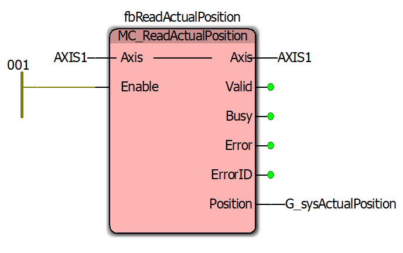

| Pin | Direction | Wired to | Note |
|---|---|---|---|
| Axis | in | `AXIS1` | |
| Enable | in | left power rail (network 001) | Always TRUE; there is no `G_cmd*` struct for the read blocks. |
| Axis | out | `AXIS1` | |
| Valid | out | not wired | The ST uses the position every scan without a validity check. |
| Busy | out | not wired | |
| Error | out | not wired | |
| ErrorID | out | not wired | |
| Position | out | `G_sysActualPosition` | mm; read throughout `PRG_Main` and the user FBs, published in IR11-12. |

## fbReadActualVelocity

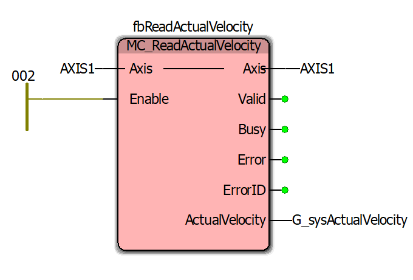

| Pin | Direction | Wired to | Note |
|---|---|---|---|
| Axis | in | `AXIS1` | |
| Enable | in | left power rail (network 002) | Always TRUE. |
| Axis | out | `AXIS1` | |
| Valid | out | not wired | |
| Busy | out | not wired | |
| Error | out | not wired | |
| ErrorID | out | not wired | |
| ActualVelocity | out | `G_sysActualVelocity` | mm/s; `G_sysInMotion`, the exit guard and the probe read it, published in IR13-14. |

## fbReadActualTorque

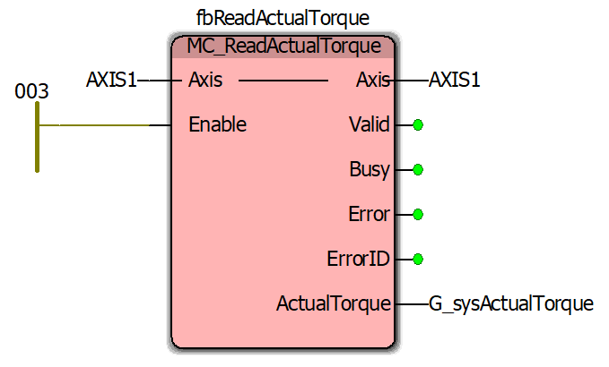

| Pin | Direction | Wired to | Note |
|---|---|---|---|
| Axis | in | `AXIS1` | |
| Enable | in | left power rail (network 003) | Always TRUE. |
| Axis | out | `AXIS1` | |
| Valid | out | not wired | |
| Busy | out | not wired | |
| Error | out | not wired | |
| ErrorID | out | not wired | |
| ActualTorque | out | `G_sysActualTorque` | % of rated; the exit guard and the probe read it, published in IR15-16. |

## fbReadStatus

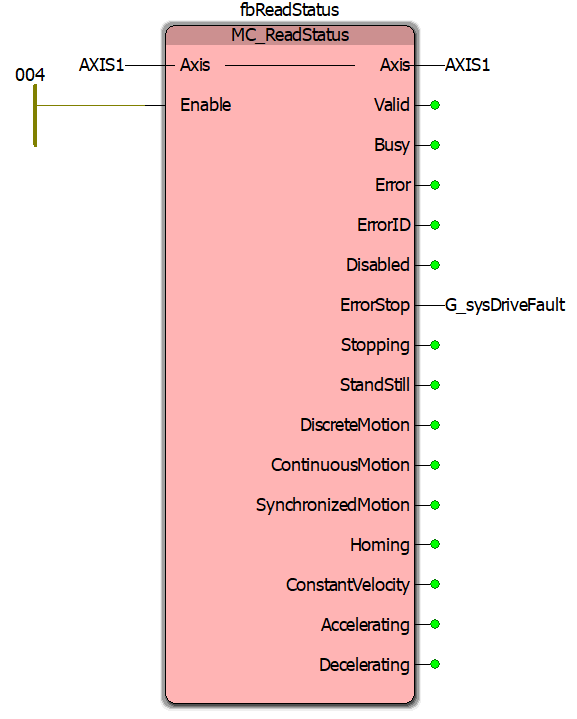

| Pin | Direction | Wired to | Note |
|---|---|---|---|
| Axis | in | `AXIS1` | |
| Enable | in | left power rail (network 004) | Always TRUE. |
| Axis | out | `AXIS1` | |
| Valid | out | not wired | |
| Busy | out | not wired | |
| Error | out | not wired | |
| ErrorID | out | not wired | |
| Disabled | out | not wired | |
| ErrorStop | out | `G_sysDriveFault` | The `DriveFault` input of `FB_SafetyMonitor` (`FAULT_DRIVE`); nothing else writes it. The axis is in ErrorStop while the SERVOPACK holds an alarm and leaves it on `fbReset`. |
| Stopping | out | not wired | |
| StandStill | out | not wired | |
| DiscreteMotion | out | not wired | |
| ContinuousMotion | out | not wired | |
| SynchronizedMotion | out | not wired | |
| Homing | out | not wired | |
| ConstantVelocity | out | not wired | |
| Accelerating | out | not wired | |
| Decelerating | out | not wired | |

## To change: remove `MC_MoveVelocity`

`G_cmdMoveVelocity` and `G_staMoveVelocity` (types `ST_CmdMoveVelocity`
and `ST_StaMoveVelocity`) no longer exist in the Structured Text, and
nothing writes or reads them. No screenshot in this directory shows an
`MC_MoveVelocity` block, so the record cannot say whether the instance is
still in the LD POU. If it is, delete it together with the two globals and
the two types. Also delete the global `G_sysCycleCount`, which `PRG_Main`
no longer increments, if the project still declares it.
